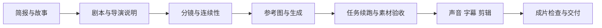

# Short Drama Studio

一个面向 AI Agent 的短剧制作 Skill：从故事、剧本、导演分镜、人物连续性，推进到视频生成、声音字幕、剪辑和成片验收。

**An Agent Skill for end-to-end short-drama production: writing, directing, storyboards, continuity, generation jobs, captions, editing, and media QA.**

## 能做什么

- 从想法、人物参考、已有剧本、分镜或现成视频进入相应阶段。
- 写可演的剧情、对白和导演说明，维护人物、场景、道具及参考图的职责。
- 根据当前模型能力安排生成段，查询价格与优惠来源，保存可续跑的任务记录。
- 通过随附 ZenMux 适配器提交视频、查询、下载与转写；也可使用其他供应商的现有工具。
- 用 FFmpeg 与 Pillow 按精确帧时间线剪辑，加入字幕、标题、独立配音和背景音乐。
- 检查完整解码、实际时长、帧数、音轨和末帧字幕，再进行人物、表演与声音检查。

Skill 负责指导 Agent 做创作与执行。真实人物画面、声音和视频需要相应生成工具或用户提供的素材；随附 Python 工具负责执行可重复的工程步骤。



可以从任意已有阶段开始，也可以只写剧本或修复一个镜头。用户已授权制作时继续推进，不给每个普通步骤额外设置确认。

## 安装

本仓库根目录就是一个标准 [Agent Skill](https://developers.openai.com/api/docs/guides/tools-skills)，入口是 [SKILL.md](SKILL.md)。在 Codex 中可克隆到个人技能目录：

```bash
git clone https://github.com/zghstart/short-drama-studio.git \
  "${CODEX_HOME:-$HOME/.codex}/skills/short-drama-studio"
```

其他支持 Agent Skills 的客户端，将整个目录放到其技能目录。脚本在 macOS / Linux 上可用；Python 和 FFmpeg 的路径可以通过环境配置替换。

创作指导本身不需要 Python 依赖。运行剪辑工具需要：

- Python 3.10 或以上。
- FFmpeg、ffprobe；FFmpeg 包含 `libx264`、AAC 和 `qtrle` 编解码能力。
- Pillow，安装命令如下。
- 中文烧录字幕还需一份支持中文的字体，例如 [Noto CJK](https://github.com/notofonts/noto-cjk)。字体由使用者提供，仓库不附带字体文件。
- ZenMux 工具还需要 curl 和通过进程环境提供的 `ZENMUX_API_KEY`。图片、其他视频或声音工具按所选工具配置。

```bash
python3 -m venv .venv
.venv/bin/python -m pip install -r requirements.txt
```

## 如何调用

在 Agent 中：

```text
使用 $short-drama-studio，把这张人物照制作成30秒都市悬疑短剧。
使用我已配置的生成服务，先固定人物和场景，最后交付带对白、字幕和配乐的MP4。
```

```text
使用 $short-drama-studio，根据这个故事写完整两分钟剧本和导演分镜。
这一轮只做前期，不生成图片或视频。
```

```text
使用 $short-drama-studio，检查这个粗剪的人物连续性和尾句字幕，直接修复受影响的部分。
```

## 本地工具

以下命令从仓库根目录运行。创建项目后，先完成创作并把真实素材绑定进 `film.json`。路径按该文件所在目录解析。

```bash
python3 scripts/timeline.py init ./projects/my-film \
  --title "示例短剧" --duration 30 --shots 3

python3 scripts/timeline.py validate ./projects/my-film/film.json

.venv/bin/python scripts/render.py ./projects/my-film/film.json \
  --font /path/to/NotoSansCJKsc-Regular.otf

python3 scripts/inspect_media.py ./projects/my-film/output/final.mp4 \
  --expected-duration 30 --expected-fps 30 --require-audio --decode \
  --frames-dir ./projects/my-film/.drama/review
```

[时间线格式](references/manifest.md) 使用整数帧：镜头 `frames` 之和必须等于 `target_frames`，字幕区间结束不包含该帧。30秒和三镜只是一组示例，不限制创作结构。

渲染器支持 `cover` 裁切或 `contain` 补边、源音轨、有意静音、独立配音和音乐。复杂转场可使用当前环境其他剪辑工具。输出已存在时，需要显式 `--overwrite` 才替换。

## ZenMux 任务工具

先通过进程环境或客户端的密钥管理方式配置 `ZENMUX_API_KEY`。[.env.example](.env.example) 仅说明字段，脚本不自动加载 `.env`。

```bash
python3 scripts/zenmux.py models --output video

# 纯本地预览，不读密钥、不联网、不提交任务。
python3 scripts/zenmux.py submit --dry-run \
  --model EXACT_MODEL_ID --prompt ./prompts/shot-01.txt \
  --image ./references/shot-01.png --duration 10 \
  --resolution VERIFIED_VALUE --job ./.drama/jobs/shot-01

# 已完成实际能力核对且获得制作授权后，去掉 --dry-run 提交。
python3 scripts/zenmux.py poll --job ./.drama/jobs/shot-01
python3 scripts/zenmux.py download --job ./.drama/jobs/shot-01

python3 scripts/zenmux.py transcribe \
  --model EXACT_ASR_MODEL_ID --audio ./.drama/voice.wav \
  --language zh --out ./.drama/transcript.json
```

准确模型 ID、协议、参考模式、分辨率、时长和优惠均以当次官方资料为准。目录存在不等于所有参数可用。已有任务目录拒绝再次提交；提交结果未知时保留未知状态，先核查再决定下一步。[生成执行](references/generation.md) 和 [ZenMux 适配](references/zenmux.md) 说明恢复方式。

请求、响应和可能带签名的 URL 留在被忽略的 `.drama/`。API 密钥不作为命令行参数，下载媒体时不向 CDN 转发密钥。工具沿用已有网络代理，macOS 也可读取现有系统 HTTPS 代理。

## 离线演示与测试

演示用三段合成色块和测试音，验证剪辑、音轨与最后一帧字幕，不调用生成 API：

```bash
python3 scripts/make_demo.py ./.drama/demo
.venv/bin/python scripts/render.py ./.drama/demo/film.json
python3 scripts/inspect_media.py ./.drama/demo/output/final.mp4 \
  --expected-duration 1.2 --expected-fps 30 --require-audio --decode
```

开发与验证：

```bash
.venv/bin/python -m pip install -r requirements-dev.txt
.venv/bin/python -m unittest discover -s tests -v
```

测试覆盖时长分配、字幕边界、付费提交去重、未知结果保护、任务续跑、凭证传递、下载哈希，以及真实 FFmpeg 合成后的末帧字幕。CI 使用合成素材，不需要 API 密钥。

## 项目结构

```text
SKILL.md                 Agent 入口
agents/openai.yaml       Codex 展示信息
references/              故事 导演 连续性 生成 后期 供应商说明
assets/                  简报 剧本 连续性模板
scripts/                 时间线 任务管理 剪辑 验收 离线演示
tests/                   离线行为与媒体测试
```

创意判断、视觉检查、听觉检查和技术验收分别进行。ASR 能检查对白内容，无法单独证明人物相似度、声线和口型。交付时区分原生生成尺寸与导出尺寸。

## 参考与许可

参考了 Dramake、drama-skills、short-drama-agent、Remotion 与 OpenAI 的技能组织和工作流资料；具体固定版本及取舍见 [参考来源](references/sources.md)。

采用 [MIT License](LICENSE)。公开仓库只包含通用说明、模板、工具与合成测试，不包含私人照片、声音、成片、凭证或任务响应。
